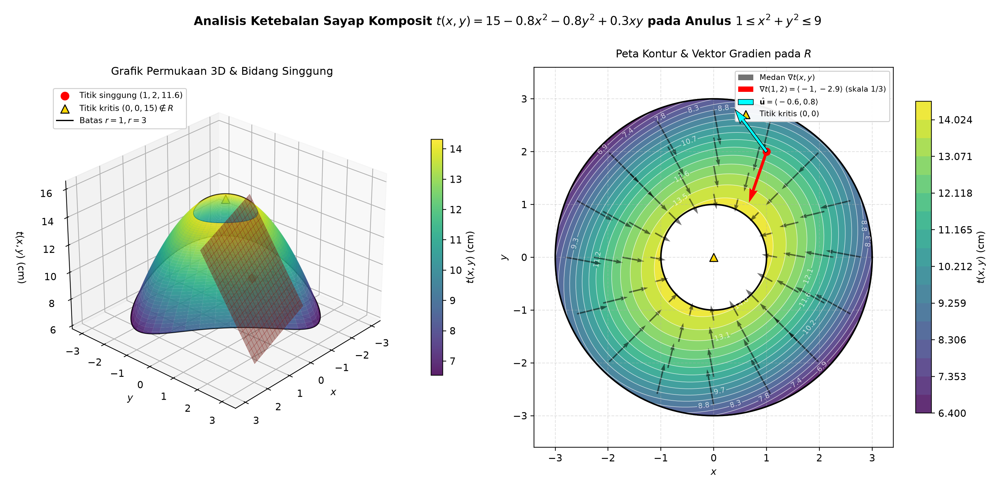
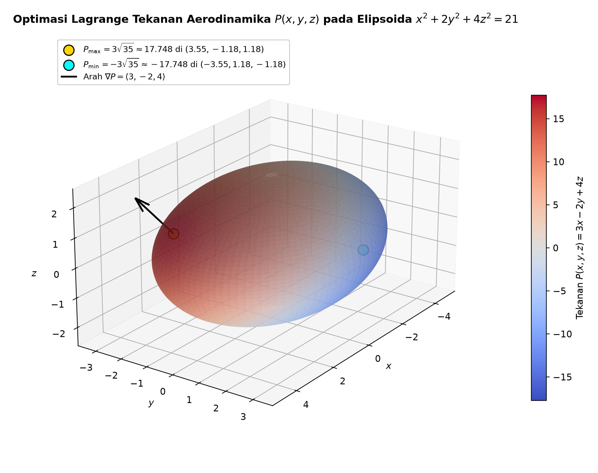
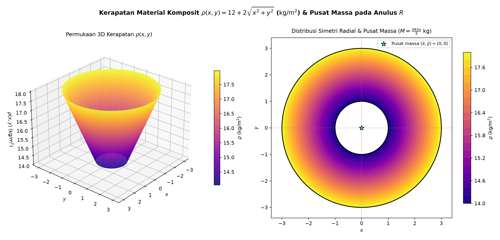

# Plot Grafik Kalkulus — Struktur Sayap Komposit

Proyek Python untuk visualisasi dan verifikasi komputasi kalkulus pada analisis struktur sayap komposit. Proyek mencakup turunan parsial, turunan berarah, bidang singgung, optimasi Lagrange, integral lipat, kerapatan material, serta pusat massa.

## Fitur

- Permukaan 3D ketebalan sayap dan bidang singgung
- Peta kontur beserta medan gradien
- Optimasi tekanan pada permukaan elipsoida
- Permukaan dan distribusi kerapatan material
- Perhitungan volume, massa, dan pusat massa
- Verifikasi numerik dengan SciPy
- Penampil 3D interaktif menggunakan Tkinter

## Struktur File

| File | Deskripsi |
|---|---|
| `analisis_komposit.py` | Perhitungan analitik, verifikasi numerik, dan pembuatan gambar grafik |
| `plot_3d_interaktif.py` | Aplikasi penampil grafik 3D interaktif |
| `plot_ketebalan_3d_kontur.png` | Visualisasi ketebalan dan gradien |
| `plot_elipsoida_lagrange_3d.png` | Visualisasi optimasi Lagrange |
| `plot_kerapatan_pusat_massa_3d.png` | Visualisasi kerapatan dan pusat massa |

## Persyaratan

- Python 3.10 atau lebih baru
- NumPy
- SciPy
- Matplotlib
- Tkinter (biasanya tersedia pada instalasi Python Windows)

## Instalasi

```powershell
pip install numpy scipy matplotlib
```

## Cara Menjalankan

### Menjalankan analisis dan menyimpan gambar

```powershell
python analisis_komposit.py
```

Tiga file PNG akan disimpan di folder proyek.

Untuk juga menampilkan grafik setelah perhitungan:

```powershell
python analisis_komposit.py --show
```

### Membuka visualisasi 3D interaktif

```powershell
python plot_3d_interaktif.py
```

Pada penampil interaktif:

- Seret mouse kiri untuk memutar grafik
- Seret mouse kanan untuk memperbesar atau memperkecil
- Gunakan slider elevasi dan azimut untuk mengatur sudut pandang
- Gunakan tombol preset untuk melihat tampilan atas, depan, atau samping

## Hasil Analisis

### Ketebalan Sayap

Fungsi ketebalan:

$$t(x,y)=15-0.8x^2-0.8y^2+0.3xy$$

Pada titik $(1,2)$:

- $t(1,2)=11.6$ cm
- $\nabla t(1,2)=\langle-1,-2.9\rangle$
- Turunan berarah terhadap $\hat{u}=\langle-0.6,0.8\rangle$ adalah $-1.72$
- Bidang singgung: $z=18.4-x-2.9y$ dalam bentuk yang benar untuk titik $(1,2,11.6)$

### Optimasi Tekanan

Tekanan aerodinamika:

$$P(x,y,z)=3x-2y+4z$$

dengan kendala:

$$x^2+2y^2+4z^2=21$$

Nilai ekstrem:

- $P_{\max}=3\sqrt{35}\approx17.74823935$
- $P_{\min}=-3\sqrt{35}\approx-17.74823935$

### Integral pada Anulus

Daerah integrasi:

$$1\leq r\leq3,\qquad 0\leq\theta\leq2\pi$$

Hasil yang diperoleh:

- Volume: $V=88\pi\approx276.46015352$
- Massa: $M=\frac{392\pi}{3}\approx410.50144007$ kg
- Pusat massa: $(\bar{x},\bar{y})=(0,0)$

## Pratinjau Visualisasi

### Ketebalan dan Gradien



### Elipsoida Lagrange



### Kerapatan dan Pusat Massa



## Lisensi

Lihat ketentuan lisensi repositori pada GitHub apabila lisensi telah ditambahkan.
